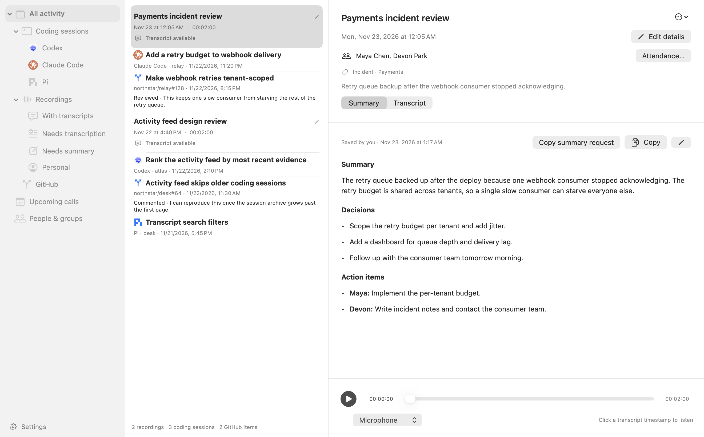

# Afterword

Afterword is a local-first, agent-agnostic tool for unifying development context.
It helps bring together disparate datasets and create a holistic view of your
development activity. Everything runs on your Mac, so your transcripts, calls,
and GitHub history stay on disk.



## What you can do with Afterword

Some example prompts:

* "Hey Claude, what did I do yesterday?" — the standup update
* "Is there anything I said I would do recently that I've forgotten about?"
* "What did Jack say about the database configuration in the incident call last week?"
* "Hey Claude, I just hit my Codex limit. Pick up where I left off."
* "Add a separate ticket to my board for each of the things I said I'd do in my call this morning."

## Getting started

Requires Apple Silicon and macOS 14.2 or later.

[Build from source](docs/development.md#build-the-app), or paste this into your
agent:

> Hey Claude/Codex/Pi/whatever, build this app for me

Install with Homebrew:
```bash
brew install --cask jbonatakis/tap/afterword
```

Note that if you install from Homebrew, macOS Gatekeeper will flag the install
as dangerous because the build has not been signed with an Apple Developer License.
Those licenses cost $99/year, and at this point that doesn't make sense for me to pay for one.

You can still install via Homebrew, but you will need to bypass the Gatekeeper
warning by going to *Settings -> Privacy & Security -> Open Anyway*. This still may not work on
enterprise managed devices. In this case, build from source as described above.

Full documentation lives in [docs](docs/README.md).

## How it works

### Sources

#### Coding agents

Session transcripts are parsed, stored, and optionally embedded, enabling browsing
and intelligent search across sessions and agents. Quickly find what you did in old sessions,
or with another agent altogether.

Supported agents: Codex, Claude Code, Pi, Google Antigravity CLI

#### GitHub

Your GitHub activity is tracked: pull requests, comments, reviews, and issues
are captured, stored, and optionally embedded.

GitHub access will require either a read-only PAT or new GitHub app installed the repo(s)
of your choice.

#### Call recordings

Record and optionally transcribe the audio of any call. Both microphone input
and speaker output are captured, allowing for accurate separation of your voice and other participants.
Afterword integrates with the macOS calendar, so when you are in a call with just one
other person it can automatically assign a speaker label for them.

In a call with multiple other participants, Afterword can perform *diarization*, splitting the speaker
output by distinct voice. After you provide labels for each voice, Afterword can remember and later suggest
accurate labels by comparing to the saved samples.

### Task board (aka Tom Mode)

This is a kanban board that can be fully managed by the agent of your choice via MCP. It supports
configurable columns and swimlanes, and tickets support direct linking to relevant content (e.g.
a message in a coding session, something someone said in a call, etc.)

### Agent integration

Afterword exposes most of its functionality through a local MCP server: search, call transcripts,
coding sessions, GitHub activity, and the task board. Any MCP client can connect to it.

Enable access in **Settings → Agent Access**, choose the permitted folders, and copy the server
path into your client. See [MCP setup, permissions, and tools](docs/mcp.md) for details.

Full list of tools:

<details>
<summary>Afterword MCP tools</summary>

| Tool | What it does |
|---|---|
| `search_activity` | Search allowed calls, coding sessions, and GitHub contributions; omit the query to browse recent or dated activity |
| `get_coding_session` | Read an imported coding session, optionally starting at a cited message |
| `get_github_item` | Read a shared issue or pull request with the account owner’s contributions |
| `list_calls` | List or search saved calls by metadata, summary, or latest transcript |
| `search_transcripts` | Search saved transcript passages with merged context windows |
| `get_call` | Read call details, transcript versions, and the current summary with history |
| `get_transcript` | Read saved transcript paragraphs with resolved speakers and timestamps |
| `save_call_summary` | Save an editable Markdown summary for a call; requires write access |
| `get_changes` | Compare the library with a saved checkpoint to get added, updated, and removed calls |
| `get_board` | Read the board name, revision, columns, swimlanes, and ticket count |
| `list_board_tickets` | Browse or search board tickets by column, swimlane, origin key, or citation |
| `get_board_ticket` | Read a ticket with its notes and source citations |
| `create_board_ticket` | Create a ticket, optionally with notes, citations, and a placement |
| `update_board_ticket` | Edit, move, or reorder a ticket |
| `add_board_reference` | Attach verified evidence to a ticket |
| `remove_board_reference` | Remove one citation from a ticket |
| `delete_board_ticket` | Delete a ticket |
| `rename_board` | Change the board name |
| `create_board_group` | Add a column or swimlane |
| `update_board_group` | Rename or reorder a column or swimlane |
| `delete_board_group` | Delete an empty column or swimlane |

</details>

Summary writes and board management each need their own grant in **Settings → Agent Access**.

## License

[MIT](LICENSE)
